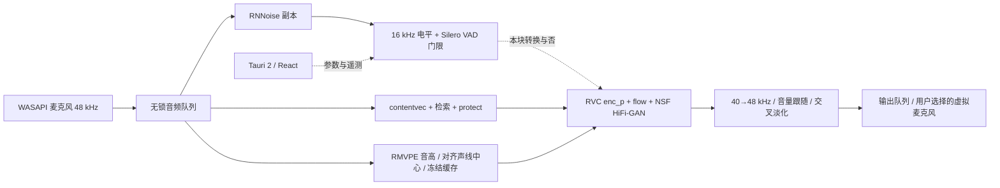

# Mimic

Mimic 是 Windows 上的实时变声器：Rust 处理 WASAPI 音频与分块调度，ONNX Runtime DirectML 运行固定的 RVC v2 模型，Tauri 2 + React 提供本地界面。目标是把麦克风转换后的声音送入用户选择的虚拟麦克风，让语音软件接收。

当前是开发原型。默认采用 **240 ms 音频块、2.5 s 历史上下文、10 ms 前瞻、100 ms 交叉淡化**，使用确定性噪声和连续 NSF 相位减少重复渲染的接缝。推理会话按布局固定维度；RNNoise 只处理给门限判定用的副本，送进模型的是原始音频；音高默认对齐声线自己的音高中心；响度起伏默认跟随说话人。仓库不附声线模型、训练集、图片或录音；`models/silero_vad.onnx` 是明确允许分发的 MIT VAD 模型例外。



详细的模型接口、状态和约束见 [架构说明](docs/ARCHITECTURE.md)。

## 构建与运行

使用 Windows 11、Rust MSVC 工具链与 Visual Studio C++ Build Tools/Windows SDK。项目采用 Rust 2024 edition，已用 Rust 1.99.1 验证。界面使用 Node.js 20.19+ 或 22.12+（以 `app/package-lock.json` 锁定的 Vite engines 为准）及 npm。

在仓库根目录启动 PowerShell：

```powershell
cargo build --locked --release --manifest-path .\engine\Cargo.toml
cargo test --locked --release --manifest-path .\engine\Cargo.toml --test dsp_parity
.\engine\target\release\mimic.exe devices
```

已有本地依赖缓存时可额外加 `--offline`。普通 DSP parity 使用仓库内的合成 fixtures；手动模型/GPU 测试被标记为 ignored，执行前需要自己的模型及空闲 GPU。

实际推理还需在 `runtime/` 放置同一发行版本的 `onnxruntime.dll`、`onnxruntime_providers_shared.dll`、`DirectML.dll`，并准备下文的模型文件。开发测试使用 onnxruntime-directml 1.24 系列；运行库不随源码提交。DirectML 初始化会预加载该目录的 DirectML.dll。

```powershell
$mimic = '.\engine\target\release\mimic.exe'
& $mimic convert '<输入.wav>' '<输出.wav>'
& $mimic live --in '<麦克风名称片段>' --out '<输出设备名称片段>'
```

请把尖括号占位符换成自己的路径和设备名称。不加 `--voice` 时使用 `models/voices` 下按名称排序的第一个声线（含 `synth.json` 的目录），`--voice <目录名>` 指定其他声线。`--pitch` 以声线的音高中心为 0：声线目录里有 `f0_stats.json` 时，引擎把说话人按 120 Hz 对齐到声线的音高中位数，`--no-align-pitch` 让 `--pitch` 回到普通的整体移调。`--envelope` 控制响度跟随，0 为关。RNNoise 默认只用于门限，`--denoise-audio` 让它也作用于送进模型的音频，`--no-denoise` 完全不用；`--vad 0` 只用电平门限。电平够、音高稳定的块（拖长的元音、滑音、哼唱）在 Silero 不认时也会开门，`--no-gate-pitch` 关掉这一条。`--dynamic-shapes` 改回动态维度会话，用于对比。先通过 `devices` 明确选设备，不更改 Windows 默认音频设备。

`live --measure` 绕过变声，向输出设备发编码脉冲、在输入端检测，统计设备往返延迟；需要显式的回环，例如 `--out "CABLE Input" --in "CABLE Output"`。测试脉冲会进入所选输出，不要在语音通话中运行。

`record <台本> <目录>` 按台本逐段录一组固定的测试录音：台本里 `# <名字>` 开头的行把它分成几段，每段先显示文字，按 Enter 开始和停止，前后各留 2 秒安静，存成 `<目录>/<名字>.wav`（48 kHz 单声道）。已经录好的段下次自动跳过，`--redo` 重录。

界面：

```powershell
Set-Location .\app
npm ci
npm run dev          # 浏览器界面，使用 mock engine
npm run tauri dev    # 本地 Rust 引擎与 Tauri 界面
npm run tauri build
```

界面在构建时收集 `models/voices/` 下的声线：每个含 `synth.json` 的目录是一个声线，同目录可选的 `profile.json` 决定它的显示方式，字段都可省略：

```json
{
  "name": "显示名",
  "codename": "VOICE",
  "region": "副标题",
  "accent": "#4fd8ff",
  "portrait": "portrait.png",
  "background": "background.png",
  "defaults": { "pitch": 0, "indexRate": 0.75 }
}
```

图片放在同一目录，完整字段见 `app/src/data/voices.ts`；没有任何声线时界面显示占位卡。打包和首次下载/更新流程尚未完成，不能把开发构建当成完整安装包。

## 训练与导出声线

目前支持带 f0 的 RVC **v2 / 768 维**模型，使用 NSF HiFi-GAN 声码器，输出 40 kHz。推理端只需要 Rust 和 ONNX Runtime；训练与导出用单独的 Python 3.12 + PyTorch 环境（NVIDIA GPU；RTX 50 系列需要 CUDA 12.8 以上的 PyTorch 构建）：

```powershell
py -3.12 -m venv train\.venv
train\.venv\Scripts\python.exe -m pip install -r train\requirements-train.txt
```

**共享网络**，每台机器导出一次。`train/pretrained.py --shared` 下载训练用的底模和两张共享网络的权重：RVC 官方 Hugging Face 仓库的 f0G40k / f0D40k 与 RMVPE，`lengyue233/content-vec-best` 的 contentvec。每个文件都固定版本，校验 sha256 后才放进 `train/pretrained/`。导出 contentvec 另需 `transformers`：

```powershell
train\.venv\Scripts\python.exe train\pretrained.py --shared
train\.venv\Scripts\python.exe tools\export\export_rmvpe.py
train\.venv\Scripts\python.exe -m pip install transformers==5.13.1
train\.venv\Scripts\python.exe tools\export\export_contentvec.py
```

**从录音训练**。`mimic prepare` 把一个文件夹的单说话人 WAV 切片、重采样，并用上面两张网络提取特征和音高；`train/train.py` 是 Applio 训练脚本的单卡精简版，网络、损失和优化设置相同。同一份数据上，它训出的模型和 Applio 训出的效果相当：损失曲线逐轮吻合，认人分数、实时退化和语调跟随都持平。

```powershell
.\engine\target\release\mimic.exe prepare '<录音目录>' '<prep 目录>'
train\.venv\Scripts\python.exe train\train.py '<prep 目录>' '<run 目录>' --epochs 300 --export my_voice
```

`--export` 在训练结束时把模型、检索向量和音高统计 `f0_stats.json` 导出到 `models/voices/my_voice/`。

**导出已有的 RVC v2 模型**（RVC / Applio 的推理 `.pth` 与 `.index`）：

```powershell
train\.venv\Scripts\python.exe tools\export\export_synth.py '<模型.pth>' my_voice
train\.venv\Scripts\python.exe tools\export\export_synth_det.py '<模型.pth>' my_voice
train\.venv\Scripts\python.exe tools\export\export_retrieval.py '<模型.index>' my_voice
train\.venv\Scripts\python.exe tools\export\export_f0_stats.py '<prep 目录>' my_voice
```

最后一行可选，要用这个声线的训练数据经 `mimic prepare` 处理后的目录。`.index` 按 FAISS 的文件格式直接读取，不需要安装 faiss。每个导出脚本都会对照 PyTorch 与 ONNX 的输出；共享网络的对照默认用合成信号，设环境变量 `MIMIC_PARITY_WAV` 可以换成自己的录音。

输出布局：

```text
models/
  contentvec.onnx
  rmvpe.onnx
  rmvpe.json
  rmvpe_mel.f32
  silero_vad.onnx                 # MIT，可随代码分发
  voices/my_voice/
    synth.onnx + synth.json
    synth_det.onnx + synth_det.json
    retrieval.onnx + retrieval.json
    f0_stats.json                 # 音高统计，可选
    profile.json                  # 可选，界面显示
```

`synth_det` 让引擎控制绝对时间噪声和起始相位，是当前无缝模式所需的可选导出；没有它时退回 legacy 路径。`f0_stats.json` 记录声线原声浊音帧的音高统计，引擎用其中的中位数 `median_hz` 做音高对齐；没有它时 `--pitch` 按普通整体移调处理。导出会生成大文件及含本地 checkpoint 路径的 metadata，这些由 `.gitignore` 排除；不要强制加入公开提交。使用的权重、索引、声音及图片各自需要独立授权，项目 MIT 许可证不授予这些资产的权利。

## 已测到什么

本地一组对齐后的 137 个语音片段，以 offline 渲染为参照的 mean log-mel L1 距离（低者较好）：Mimic 240 ms / 2.5 s context 为 **4.03 dB**，Applio realtime 250 ms 为 **4.14 dB**。这是特定模型/测试集的客观距离，不是通用 MOS 或所有声音上的胜出结论；输入数据不公开。

固定维度 session 的独立 A/B 在同一真实输入上测得总块耗时中位数 **54.04→41.42 ms**、p95 **56.18→43.76 ms**，最大采样误差 **4.465e-6**；另一次复测为 53.0→40.4 ms。它已是 CLI 和界面的默认，`--dynamic-shapes` 可复现旧路径。

实际端到端延迟包含攒块、前瞻、推理、输出排队和设备缓冲，当前没有达成或宣称 ≤200 ms 的目标。较短块的接缝与机械感仍是主要研究问题；240 ms 是当前质量/开销折中。

## 许可与边界

项目代码使用 [MIT](LICENSE)，保留 Applio 移植部分的 `Copyright (c) 2026 AI Hispano`；`tools/export/rmvpe_net.py` 的 RMVPE 网络定义来自 Dream-High/RMVPE，按 Apache-2.0，见 `tools/export/LICENSE-RMVPE`。随源码保留的 Silero VAD 按其 [上游 MIT 许可](https://github.com/snakers4/silero-vad/blob/master/LICENSE) 保留 `Copyright (c) 2020-present Silero Team`。其他依赖继续遵循各自许可证；下载的研究模型及第三方源码副本不作为本项目自有代码重新授权。

Mimic 是用户态音频软件，通过用户选择的虚拟音频设备与语音软件连接，不读取或修改游戏进程，不注入 DLL，也不安装音频驱动。界面热键由普通应用快捷键插件处理，未实现游戏进程挂钩。这描述当前实现，不构成任何游戏或反作弊系统的兼容性认证。VB-Cable 单独由用户安装；源码和安装包不夹带它。GPU 导出和重型 benchmark 应在游戏关闭时运行。

## English summary

Mimic is an experimental Windows real-time voice converter built with Rust, WASAPI, ONNX Runtime DirectML, and Tauri 2/React. It runs RVC v2 voices exported to ONNX by the scripts in `tools/export`; `train/` holds a single-GPU RVC v2 trainer that matches Applio's results on the same data, and the shared networks (contentvec, RMVPE) are exported from their published weights, so neither training nor export needs Applio. The current default is a 240 ms block with 2.5 s of context, 10 ms lookahead and a 100 ms crossfade; deterministic excitation and continuous phase reduce chunk seams. Voice models, datasets, artwork, and recordings are not included. The MIT-licensed Silero VAD is the only bundled model. Source code is MIT with upstream notices preserved. This is user-mode audio processing, with no game-process access or injection, and no claimed anti-cheat certification.
